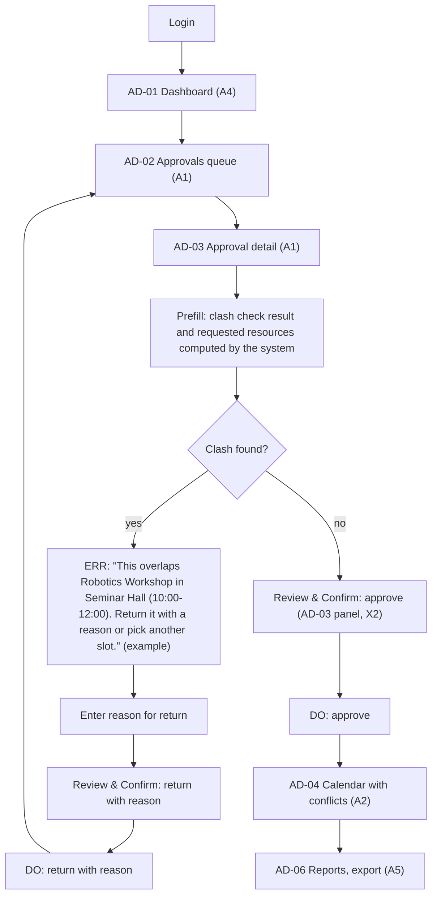

# Flow: Admin decides on a pending event

Confidence: derived (AI-drafted, not user-tested)

Goal: decide pending events quickly with the clash check already done (A1, A2, A5, X2, X5; `dom-flows`).

## Reading the flow
- Approve is only offered when no clash exists; with a clash the admin returns the event with a reason.
- Export on AD-06 is not irreversible, so it has no Review & Confirm.
