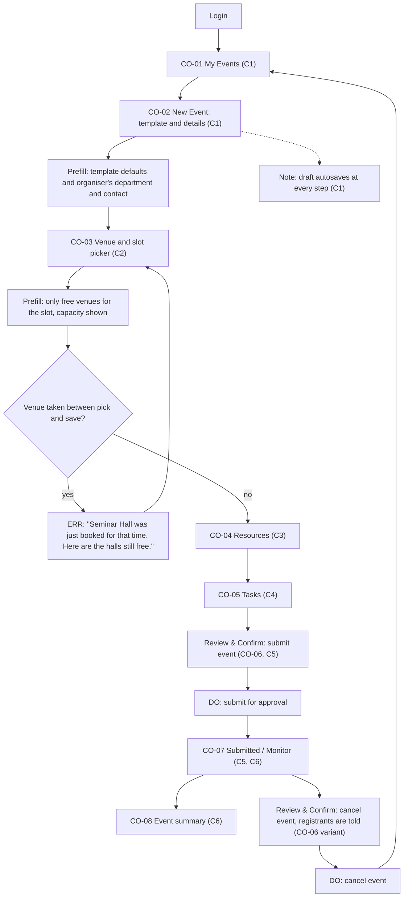

# Flow: Coordinator creates and submits an event

Confidence: derived (AI-drafted, not user-tested)

Goal: get a clash-free event approved with venue, resources and tasks in as few steps as possible (C1-C5, X2, X5; `dom-flows`, `dom-status-vocabulary`).

## Reading the flow
- `Prefill:` the system already knows this, so the coordinator confirms instead of typing.
- `RCn` nodes are Review & Confirm screens. Every `DO:` (irreversible) node is entered directly from one.
- `ERR:` nodes show the plain-language message. The venue clash is also impossible in the database (`dom-domain-model`).
- Cancelling is only offered from Monitor, after the review step, with the effect on registrants stated.
