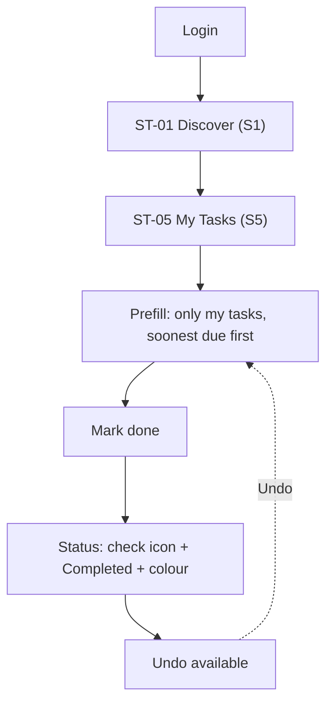

# Flow: Student organizer marks a task done

Confidence: derived (AI-drafted, not user-tested)

Goal: show the organizer only their own tasks and let them tick one off in one step (S5; `dom-status-vocabulary`).

This action is reversible, so no Review & Confirm node is used (auto-mode answer 1, X2). Undo is available instead.

## Reading the flow
- Status is shown as icon, text and colour from the shared vocabulary, never colour alone.
