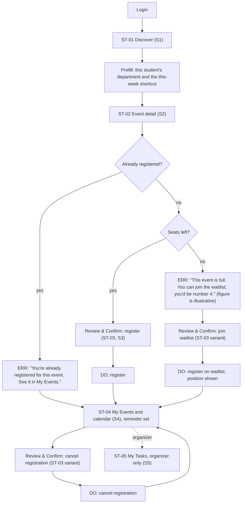

# Flow: Student registers for an event

Confidence: derived (AI-drafted, not user-tested)

Goal: find an event worth attending and register in as few interactions as possible (S1-S4, X2; `dom-flows`).

## Reading the flow
- Double registration is blocked in the database and in the UI (`dom-domain-model`); the `ERR:` message sends the student to where the registration lives.
- The waitlist number in the full-event message is illustrative, not observed data.
- Organizer branch: see `organizer-mark-task-done.md`.
