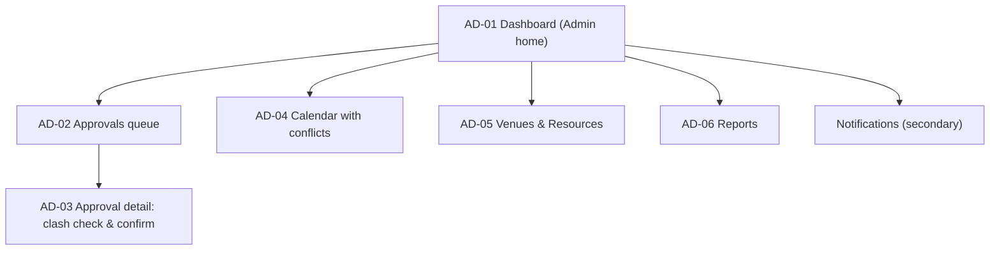

# Admin interface: information architecture

Confidence: derived (AI-drafted, not user-tested)

Role goal: decide quickly and safely, with clashes surfaced before approval (`dom-goals-tasks`, `dom-flows`). Device priority: desktop-first, left sidebar collapsing to a menu (D-08).

AD-01 is the Admin home, shown above Approvals. It is not a nav item, so navigation stays at five and not six (D-06).

## Sitemap

## Navigation

| Item | Screen id | Goal served | Req ids |
|---|---|---|---|
| Approvals | AD-02 | Decide pending events | A1 |
| Calendar | AD-04 | See utilisation and conflicts | A2, X1 |
| Venues & Resources | AD-05 | Keep venues and resources current | A3 |
| Reports | AD-06 | Produce reports | A5, A4 |
| Notifications | secondary screen | Know what needs attention | X1 |

## Screens

| Screen id | Screen | Req ids |
|---|---|---|
| AD-01 | Dashboard (home) | A4, X1 |
| AD-02 | Approvals queue | A1 |
| AD-03 | Approval detail with clash check and confirm panel for approve/return | A1, X2, X5 |
| AD-04 | Calendar with conflicts | A2, X1 |
| AD-05 | Venues and Resources | A3 |
| AD-06 | Reports | A5, A4 |

## Secondary screens

- Notifications
