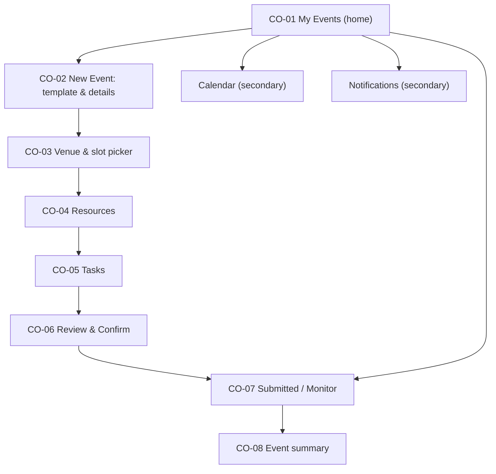

# Coordinator interface: information architecture

Confidence: derived (AI-drafted, not user-tested)

Role goal: get an event approved and running with the fewest steps (`dom-goals-tasks`, `dom-flows`). Device priority: desktop-first, left sidebar collapsing to a menu on narrow screens (D-08).

## Sitemap

## Navigation

| Item | Screen id | Goal served | Req ids |
|---|---|---|---|
| My Events | CO-01 | Find and monitor my events | C1, C6 |
| Calendar | secondary screen | See slots and clashes before choosing | C2, X5 |
| Tasks | CO-05 | Allocate and track event tasks | C4 |
| Notifications | secondary screen | Know what changed without checking | X1 |

## Screens

| Screen id | Screen | Req ids |
|---|---|---|
| CO-01 | My Events (home) | C1, C6, X1, X3 |
| CO-02 | New Event: template and details | C1, X4 |
| CO-03 | Venue and slot picker | C2, X5 |
| CO-04 | Resources | C3 |
| CO-05 | Tasks | C4 |
| CO-06 | Review and Confirm (submit; also the edit/cancel variant) | C5, C7, X2 |
| CO-07 | Submitted / Monitor | C5, C6, X1 |
| CO-08 | Event summary | C6 |

## Secondary screens

- Calendar
- Notifications

Calendar and Notifications reuse the layout pattern defined for ST-04/ST-06 and AD-04 per `docs/ia/shared-vocabulary.md`.
