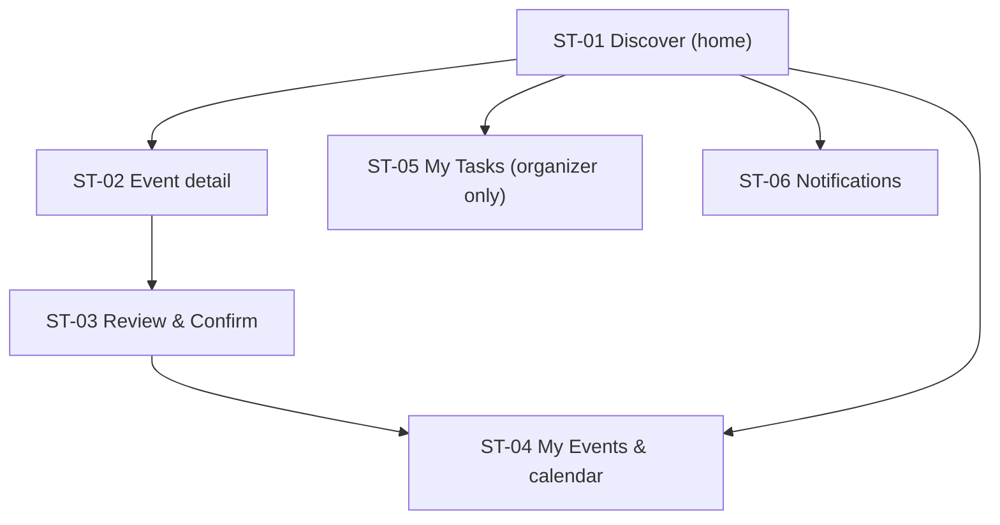

# Student interface: information architecture

Confidence: derived (AI-drafted, not user-tested)

Role goal: find an event and be registered in as few steps as possible, then keep track of it (`dom-goals-tasks`, `dom-flows`). Device priority: mobile-first with a bottom tab bar (D-08).

The Organizer is a flag on the Student interface, not a fourth interface: only organizers see the My Tasks tab (D-02, `adr-002-roles`, assumed).

## Sitemap

## Navigation

| Item | Screen id | Goal served | Req ids |
|---|---|---|---|
| Discover | ST-01 | Find an event worth attending | S1, X1, X3 |
| My Events | ST-04 | See what I am registered for | S4 |
| My Tasks | ST-05 | Organizer only, tab hidden for other students | S5 |
| Notifications | ST-06 | Reminders and changes | S4 |

## Screens

| Screen id | Screen | Req ids |
|---|---|---|
| ST-01 | Discover | S1, X1, X3 |
| ST-02 | Event detail | S2, X1 |
| ST-03 | Review and Confirm (register; waitlist, cancel variants) | S3, X2, X5 |
| ST-04 | My Events and calendar | S4 |
| ST-05 | My Tasks, organizer only | S5 |
| ST-06 | Notifications | S4 |
