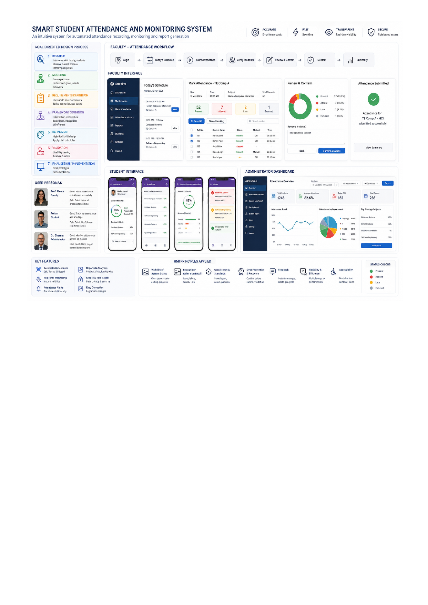

### 

### 

### **Goal-Directed Design Process – Smart Student Attendance and Monitoring System**

| GDD Phase | Application to the Attendance System | Expected Student Output |
| ----- | ----- | ----- |
| **1\. Research** | Identify the current attendance process and understand how faculty, , and administrators record, verify, and monitor attendance. Observe problems such as manual entry, proxy attendance, calculation errors, and difficulty in finding attendance records. | User interviews, observations, questionnaires, existing-system study |
| **2\. Modeling** | Develop user models/personas based on research findings. Typical users are **Faculty**, **Student**, and **Department Administrator**. Identify their goals, behaviors, frustrations, and technology usage. | Personas, user goals, behavioral patterns |
| **3\. Requirements Definition** | Convert user goals into functional and interaction requirements. For example, faculty should be able to quickly start an attendance session, verify , correct legitimate errors, and submit attendance.  should be able to view their attendance percentage and alerts. | User requirements, task analysis, user scenarios, use cases |
| **4\. Framework Definition** | Design the overall interaction framework: navigation, dashboard structure, attendance workflow, information hierarchy, feedback mechanisms, error handling, and screen relationships. | Information architecture, task flow, navigation map, wireframes |
| **5\. Refinement** | Develop detailed interface designs. Apply HMI principles such as visibility, feedback, consistency, affordance, error prevention, recognition rather than recall, and accessibility. | High-fidelity prototype, interactive prototype |
| **6\. Validation** | Conduct usability testing with representative users. Ask faculty/ to perform tasks such as marking attendance, correcting an entry, checking attendance percentage, and generating a report. Identify usability problems and refine the design. | Usability test plan, test results, observations, design improvements |
| **7\. Final Design / Implementation** | Develop the final interactive prototype or application based on validated design decisions. Demonstrate how the system reduces faculty effort and improves attendance visibility for  and administrators. | Final prototype/application and design documentation |

### **1\. Identify the Users**

**Primary users**

* **Faculty** – records and manages attendance.  
*  – view their attendance and attendance alerts.  
* **Department Administrator** – monitors attendance across classes/divisions and generates reports.

### **2\. Identify User Goals**

| User | Primary Goal | Secondary Goals |
| ----- | ----- | ----- |
| **Faculty** | Record attendance quickly and accurately | Correct errors, view attendance history, generate reports |
| **Student** | Know current attendance status | View subject-wise attendance, receive shortage alerts |
| **Administrator** | Monitor attendance across classes | Generate reports, identify attendance shortages, track faculty compliance |

### **3\. Example User Scenario**

**Scenario: Faculty taking attendance**

> A faculty member enters the classroom and opens the attendance system. The system automatically identifies the scheduled lecture and displays the corresponding class and subject. The faculty initiates the attendance session and  are automatically identified through the selected authentication mechanism. The interface clearly displays attendance status and highlights exceptions. Before submission, the faculty reviews the attendance summary and confirms the record.  can subsequently view their updated attendance percentage.

### **4\. Goal-Directed User Flow**

**Faculty**

Login → Today's Schedule → Select Lecture → Start Attendance → Student Verification → Review Attendance → Correct Exceptions → Confirm & Submit → Attendance Summary

**Student**

Login → Dashboard → Attendance → Subject-wise Attendance → Percentage → Shortage/Alert → Attendance History

**Administrator**

Login → Attendance Dashboard → Select Division/Subject → View Statistics → Identify Shortage → Generate Report

### **5\. Important HMI Problems  Should Solve**

Instead of simply creating an attendance database, the mini-project should investigate:

* How can attendance be recorded with **minimum interaction time**?  
* How can the interface prevent **accidental or duplicate attendance entries**?  
* How can faculty immediately recognize **absent/present/unverified** ?  
* How can the system provide clear **feedback after attendance submission**?  
* How can  understand their attendance status **without interpreting complex tables**?  
* How should the system highlight **attendance shortage** without overwhelming the user?  
* How can errors be **detected and corrected easily**?  
* How can the interface support users with different levels of technical expertise?  
* How can attendance information be presented through **effective visualizations**?  
* How can the system maintain **consistency and visibility of system status**?

**Project:** **Smart Student Attendance and Monitoring System – A Goal-Directed HMI Design**

**Objective:**  
 Design and prototype a user-centered attendance management system using the **Goal-Directed Design process**.  should conduct user research, develop personas, identify user goals, define requirements, design interaction flows and wireframes, develop a high-fidelity prototype, and conduct usability testing with representative users.

**Minimum deliverables:**

1. User research  
2. User personas  
3. User goals and task analysis  
4. User scenarios  
5. Requirements  
6. Information architecture  
7. User/task flow  
8. Low-fidelity wireframes  
9. High-fidelity interactive prototype  
10. Usability testing  
11. Usability findings  
12. Iterative design improvements  
13. Final prototype

### 

### 

### 

### 

### 

### **1\. Research – Understand the Users**

The first stage of Goal-Directed Design is **Research**.

The system considers three major users:

* **Faculty** – wants to record attendance quickly and accurately.  
* **Student** – wants to know their current attendance and shortage status.  
* **Administrator** – wants to monitor attendance across classes and generate reports.

The **User Personas** section represents this stage.

For example:

> **Faculty goal:** “Mark attendance quickly and accurately.”

> **Student goal:** “Track my attendance and identify shortages.”

> **Administrator goal:** “Monitor attendance across all classes.”

The personas also identify **pain points**, which help the designer understand why the existing system needs improvement.

---

### **2\. Modeling – Convert Research into User Models**

After research, GDD creates **personas and user models**.

The system shows three personas:

| Persona | Goal | Pain Point |
| ----- | ----- | ----- |
| Faculty | Mark attendance quickly and accurately | Manual attendance takes time |
| Student | Track attendance and shortage | Does not know real-time status |
| Administrator | Monitor attendance across classes | Difficult to obtain consolidated reports |

This is important because the designer does not design **one generic interface for everyone**.

Instead:

**Faculty → Attendance interface**

**Student → Attendance/alert interface**

**Administrator → Monitoring dashboard**

This is a key characteristic of **Goal-Directed Design**.

---

### **3\. Requirements Definition – What Does Each User Need?**

The next stage converts user goals into **requirements**.

For example:

#### **Faculty requirements**

* View today's timetable  
* Start attendance  
* Identify   
* Mark attendance  
* Correct errors  
* Review attendance  
* Submit attendance  
* Generate reports

#### **Student requirements**

* View overall attendance  
* View subject-wise attendance  
* Identify attendance shortage  
* Receive alerts  
* View attendance history

#### **Administrator requirements**

* View attendance statistics  
* Compare divisions/classes  
* Identify shortage  
* Monitor trends  
* Generate reports

The **Faculty Attendance Workflow** directly represents these requirements.

---

## **4\. Framework Definition – Design the Interaction Structure**

This is one of the most visible parts of the design model.

The faculty workflow is:

**Login → Today's Schedule → Start Attendance → Verify  → Review & Correct → Submit → Summary**

This is an example of designing the interface around the **user's goal and task sequence**.

Instead of giving faculty a complicated menu containing dozens of functions, the interface guides them through the actual task they want to accomplish:

> **“I want to record today's attendance.”**

The **Today's Schedule** screen is particularly important.

The system already knows:

* Subject  
* Class  
* Time  
* Number of 

Therefore, the faculty does not need to repeatedly enter this information.

This demonstrates **Goal-Directed Design \+ reduced cognitive load**.

---

# **5\. Refinement – Detailed Interface Design**

The next GDD stage is **Refinement**.

This is where the detailed UI shown in the design model is created.

### **Faculty Interface**

The faculty dashboard contains:

* Today's Schedule  
* Mark Attendance  
* Student list  
* Present/Absent/Late status  
* QR/manual attendance options  
* Search  
* Review screen  
* Confirmation

Notice the **Present / Absent / Late / Excused** summary.

This provides **visibility of system status**.

The faculty can immediately understand:

> 52 Present | 7 Absent | 2 Late | 1 Excused

rather than manually counting records.

---

# **6\. Goal-Directed Design and HMI Principles**

The interface also demonstrates several important HMI principles.

### **Visibility of System Status**

The system continuously shows attendance status.

For example:

**52 Present**

**7 Absent**

**2 Late**

The user does not have to guess whether the attendance has been recorded.

---

### **Recognition Rather Than Recall**

The faculty does not need to remember:

* Which lecture is scheduled  
* Which class is assigned  
* How many  are registered

The **Today's Schedule** automatically presents this information.

Similarly, the student interface displays subject-wise attendance directly.

---

### **Error Prevention**

Before final submission, the system provides:

**Review & Confirm → Confirm & Submit**

This is important.

Instead of allowing the faculty to accidentally submit incorrect attendance, the system provides an opportunity to review it.

---

### **Feedback**

After submission, the interface displays:

**Attendance Submitted Successfully**

with a confirmation indicator.

This provides immediate feedback that the user's action has been completed.

---

### **Consistency**

The same concepts are represented consistently:

* Present  
* Absent  
* Late  
* Excused  
* Attendance percentage  
* Alerts

Consistent visual representation makes the system easier to learn.

---

### **Error Recovery**

The **Review & Correct** screen allows faculty to correct legitimate mistakes before final submission.

This supports the HMI principle:

> **Users should be able to recover from errors rather than being permanently affected by them.**

---

# **7\. Student Interface – Goal: “Know My Attendance”**

The student interface is designed around a different goal.

The student does **not** need the complete administrative attendance database.

The student's primary question is:

> **“What is my attendance status?”**

Therefore, the interface provides:

**Overall Attendance → Subject-wise Attendance → Attendance Details → Alerts**

For example:

**Overall: 78%**

and subject-wise values such as:

* HCI – 82%  
* Database Systems – 68%  
* Software Engineering – 72%

The system also identifies **shortage subjects**.

This is goal-directed because the interface prioritizes the information the student actually needs.

---

# **8\. Administrator Interface – Goal: “Monitor Attendance”**

The administrator has a completely different goal.

Instead of looking at one student's attendance, the administrator needs a **macro-level view**.

Therefore, the interface provides:

* Total   
* Average attendance  
*  below threshold  
* Total classes  
* Attendance trends  
* Department-wise attendance  
* Shortage subjects  
* Reports

This is why the design model contains an **Administrator Dashboard**.

The dashboard transforms large amounts of attendance data into **quickly understandable visual information**.

---

# **9\. Validation – Test Whether the Design Achieves the Goals**

The final GDD stage is **Validation**.

 developing this HMI project should test the prototype with representative users.

For example, give the faculty this task:

> **Task:** Record attendance for today's HCI lecture and submit it.

Measure:

* Time taken  
* Number of clicks/interactions  
* Errors made  
* Whether the user understands the interface  
* Whether the user can correct an error  
* Whether the user knows that attendance was successfully submitted

For :

> **Task:** Find your attendance percentage in Database Systems and determine whether you have an attendance shortage.

For administrators:

> **Task:** Identify subjects where attendance is below the required threshold and generate a report.

The results should then be used to **modify the interface**.

---

# **Complete GDD Mapping of the design model**

| GDD Stage | What is Represented in the design model |
| ----- | ----- |
| **1\. Research** | Understanding faculty, student and administrator problems |
| **2\. Modeling** | Three user personas |
| **3\. Requirements Definition** | User goals, workflows and required functions |
| **4\. Framework Definition** | Navigation, attendance workflow and information architecture |
| **5\. Refinement** | Detailed faculty, student and administrator interfaces |
| **6\. Validation** | Usability testing and iterative improvements |
| **7\. Final Design** | Final interactive attendance management interface |

### **The key concept to teach** 

The most important distinction is:

**Feature-driven design:**

> “The system should have QR attendance, reports, dashboards, alerts, etc.”

**Goal-directed design:**

> “The faculty's goal is to record attendance quickly and accurately. Therefore, what is the minimum interaction needed to achieve that goal?”

Similarly:

> **Student goal:** Know attendance status → simple attendance dashboard.

> **Faculty goal:** Record attendance → schedule-driven attendance workflow.

> **Administrator goal:** Monitor attendance → analytical dashboard.

So, the design model demonstrates that **the interface is a consequence of user goals**, which is the central idea of **Goal-Directed Design**.

# 

# 

# 

# 

# **1\. Universal Design Applied to the Attendance System**

The design model is divided into seven sections. The first section shows the major Universal Design principles being evaluated.

### **A. Equitable Use**

The system should provide comparable functionality to different users.

For example:

* Faculty can mark attendance.  
*  can view attendance.  
* Administrators can monitor attendance.  
* Users with accessibility requirements should also be able to perform their tasks.

**Evaluation question:**

> Can different users accomplish their intended task without being unnecessarily excluded?

---

### **B. Flexibility in Use**

The system should support different ways of performing a task.

For example, the design model shows:

**QR/automated attendance \+ manual attendance**

A faculty member could use automated identification when available, but should also have an alternative method when it is not.

Similarly,  may access the system through different devices.

**Evaluation question:**

> Does the interface provide appropriate alternatives when users have different preferences or circumstances?

---

### **C. Simple and Intuitive Use**

The interface should not require extensive training.

For example, the student dashboard immediately shows:

**Overall Attendance: 78%**

and provides options such as:

* View Schedule  
* View Attendance  
* View Alerts  
* View Details

The user should understand what to do without reading a lengthy manual.

**Evaluation question:**

> Can a first-time user understand the interface and complete the task?

---

# **2\. Perceptible Information**

Information should be understandable through different forms of presentation.

For attendance, the system should not depend only on colour.

For example:

❌ Red \= Absent

is insufficient by itself.

Instead:

**🔴 Absent**

or

**Absent – 7** 

should be displayed.

This is particularly important for users with **colour-vision deficiencies**.

The design model also demonstrates:

* Icons  
* Text labels  
* Charts  
* Status indicators  
* Visual feedback

### **Evaluation question**

> Can users understand important information even if they cannot perceive one particular visual characteristic?

---

# **3\. Tolerance for Error**

A good Universal Design should help users **avoid errors and recover from them**.

For example, when faculty submits attendance, the system provides:

**Review → Confirm & Submit**

rather than immediately submitting the record.

The interface can also provide:

> "Are you sure you want to submit attendance?"

with:

**Yes, Submit | Cancel**

This reduces accidental submissions.

### **Evaluation question**

> Does the interface prevent serious errors and provide an easy way to recover from mistakes?

---

# **4\. Low Physical Effort**

The system should minimize unnecessary interaction.

For example, faculty should not have to:

1. Select department  
2. Select semester  
3. Select division  
4. Select subject  
5. Enter lecture time  
6. Enter student list

every time attendance is recorded.

Instead, the system can use the timetable:

**Today's Schedule → HCI → TE Comp A → Start Attendance**

This reduces interaction effort.

### **Evaluation question**

> Can users complete frequent tasks with minimum unnecessary interaction?

---

# **5\. Size and Space for Interaction**

Buttons, controls, menus, and touch targets should have adequate size and spacing.

For example:

**Confirm & Submit**

should be clearly distinguishable from:

**Cancel**

This reduces accidental selection, particularly on touch devices.

The same principle applies to:

* Navigation buttons  
* Attendance controls  
* Search fields  
* Filters  
* Alerts

---

# **6\. Accessibility Considerations**

The design model identifies five important accessibility areas.

### **Visual Accessibility**

The interface should support:

* Adequate contrast  
* Scalable text  
* Clear typography  
* Colour-independent status indicators  
* Zoom

For example:

**A− | A | A+**

allows users to adjust text size.

---

### **Hearing Accessibility**

If the system provides audio notifications, equivalent visual feedback should be available.

For example:

Instead of only:

🔊 *"Attendance submitted."*

provide:

✅ **Attendance submitted successfully**

---

### **Motor Accessibility**

Users should not be forced to perform precise or repetitive actions.

The system can support:

* Keyboard navigation  
* Larger controls  
* Logical tab order  
* Minimal steps

---

### **Cognitive Accessibility**

The interface should reduce cognitive load through:

* Simple language  
* Consistent navigation  
* Clear headings  
* Step-by-step workflows  
* Familiar icons  
* Clear error messages

For example:

Instead of:

> **ERR-ATD-503**

use:

> **Attendance could not be submitted. Please check your connection and try again.**

---

### **Language Accessibility**

The design model demonstrates the possibility of **multi-language support**.

For example:

**Attendance**

could potentially be presented in:

* English  
* Hindi  
* Marathi

This can help users who are more comfortable with different languages.

---

# **7\. Evaluation Techniques**

The design model also identifies several ways in which Universal Design can actually be **evaluated**.

## **A. Heuristic Evaluation**

An HMI evaluator examines the interface against established usability and accessibility principles.

For example:

| Evaluation Question | Observation |
| ----- | ----- |
| Is system status visible? | Attendance percentage is continuously visible |
| Is feedback provided? | Submission confirmation is displayed |
| Can users recover from errors? | Review & Correct option is available |
| Is information understandable? | Text \+ icons \+ charts are used |
| Is the interface consistent? | Similar controls use consistent layouts |

---

## **B. User Testing with Diverse Users**

Instead of testing only with technically skilled , test with different categories of users.

The design model identifies:

* Faculty  
*   
* Administrators  
* Elderly users  
* Users with visual impairment  
* Users with motor impairment  
* Users in bright light  
* Users with low digital literacy  
* Users with slow Internet

This is an important Universal Design concept.

### **Example**

Give the same task to different users:

> **"Check your attendance in HCI and determine whether you have a shortage."**

Observe:

* Can they find the information?  
* How long does it take?  
* Do they make errors?  
* Do they understand the percentage?  
* Do they understand the shortage alert?

---

# **8\. Cognitive Walkthrough**

The evaluator can perform the task step-by-step from the user's perspective.

For example:

### **Task: View attendance**

**Step 1:** Login

**Step 2:** Open Dashboard

**Step 3:** Select Attendance

**Step 4:** Select Subject

**Step 5:** View percentage

At every step ask:

> **Will the user know what to do?**

> **Will the user notice the correct control?**

> **Will the user understand the feedback?**

This is particularly useful for evaluating the interface for **first-time users**.

---

# **9\. Accessibility Checklist**

The interface can also be evaluated using an accessibility checklist.

For example:

| Check | Yes/No |
| ----- | ----- |
| Sufficient colour contrast | ✓ |
| Information not conveyed by colour alone | ✓ |
| Text can be enlarged | ✓ |
| Keyboard navigation available | ✓ |
| Buttons adequately sized | ✓ |
| Clear error messages | ✓ |
| Consistent navigation | ✓ |
| Alternative text for important icons/design models | ✓ |
| Accessible forms | ✓ |
| Clear labels | ✓ |

For a formal academic project,  can relate this evaluation to **WCAG** accessibility guidelines.

---

# **10\. Task Success Rate**

The final evaluation should measure whether users can actually accomplish their goals.

For example:

### **Faculty Task**

> Mark attendance for TE Computer Engineering – Division A.

Measure:

* Completion rate  
* Time taken  
* Number of errors  
* Number of interactions  
* User satisfaction

### **Student Task**

> Find the attendance percentage for Database Systems.

Measure:

* Task completion  
* Time taken  
* Errors  
* User understanding

### **Administrator Task**

> Identify subjects with attendance below the required threshold.

Measure:

* Task completion  
* Information-finding time  
* Errors  
* Satisfaction

---

# **11\. What the Evaluation Should Ultimately Establish**

The bottom section of the design model shows the desired outcomes:

**Increased Usability → Higher Accessibility → Reduced Errors → Greater Satisfaction → Compliance Readiness**

The ultimate goal is:

> **An attendance system that can be used effectively by the maximum number of users without requiring a separate or specialized interface.**

---

## **How to Explain \-**  

### **Traditional usability evaluation**

> **"Can a normal student use the attendance system easily?"**

### **Universal Design evaluation**

> **"Can  with different ages, abilities, languages, levels of digital literacy, devices, and environmental conditions use the attendance system effectively?"**

That difference is the **core concept of Universal Design as an evaluation technique**.

### **Simple evaluation framework**

**Users → Tasks → Universal Design Principles → Evaluation → Problems → Redesign → Re-evaluation**

For this project:

**Faculty / Student / Administrator**  
 ↓  
 **Mark / View / Monitor Attendance**  
 ↓  
 **Equitable \+ Flexible \+ Simple \+ Perceptible \+ Error-tolerant \+ Accessible**  
 ↓  
 **Heuristic Evaluation \+ Cognitive Walkthrough \+ Diverse User Testing \+ Accessibility Checklist**  
 ↓  
 **Identify Usability Problems**  
 ↓  
 **Redesign Interface**  
 ↓  
 **Test Again**

